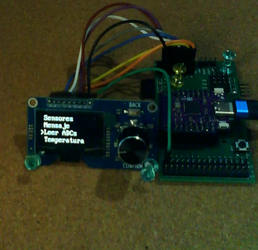

# MenuOLED



## Nota

* En el desarrollo de esta librería se ha utilizado un LOLIN S2 mini con un Módulo OLED Estardyn de 1.3 Pulgadas con Controlador SH1116 / Codificador EC11 integrado en el módulo. En este caso podríamos elegir cualquier combinación de los pines expuestos en el LOLIN S2 mini.
* Si se utiliza otro display con controladora SSD1306 se ha de cambiar la librería sh1116_fonts por la [ssd1306_fonts](https://github.com/jorts64/MicroPythonLibrariesS2mini/tree/main/ssd1306_fonts), que ofrece las mismas funciones a alto nivel.
* La resolución del display empleado es 128x64 píxels. Displays con otras resoluciones pueden necesitar una adaptación de la librería.

## Documentación de la librería para MicroPython

**Versión:** 1.0  
**Plataforma:** ESP32-S2 Mini (Lolin S2 Mini)  
**Pantalla:** SH1116, 128 × 64 píxeles  
**Control:** Encoder rotatorio con pulsador  
**Fuente recomendada:** VGA 8 × 16  
**Dependencias:** `sh1116_fonts`, `vga2_fonts_8x16` y `encoder`

---

## Índice

1. [Descripción](#1-descripción)
2. [Características](#2-características)
3. [Hardware y conexiones](#3-hardware-y-conexiones)
4. [Instalación](#4-instalación)
5. [Inicialización](#5-inicialización)
6. [Definición de menús](#6-definición-de-menús)
7. [Navegación](#7-navegación)
8. [Callbacks del encoder](#8-callbacks-del-encoder)
9. [API completa](#9-api-completa)
10. [Edición de valores numéricos](#10-edición-de-valores-numéricos)
11. [Deshabilitar y recuperar los menús](#11-deshabilitar-y-recuperar-los-menús)
12. [Ejemplo: lectura de entradas ADC](#12-ejemplo-lectura-de-entradas-adc)
13. [Bucle principal de la aplicación](#13-bucle-principal-de-la-aplicación)
14. [Limitaciones y consideraciones](#14-limitaciones-y-consideraciones)
15. [Solución de problemas](#15-solución-de-problemas)

---

# 1. Descripción

`MenuOLED` es una librería para crear sistemas de menús utilizando una pantalla OLED SH1116 y un encoder rotatorio con pulsador.

Su objetivo es separar la lógica de navegación y presentación de la lógica de la aplicación. El programa principal define las opciones de cada menú y las funciones que deben ejecutarse, mientras que `MenuOLED` gestiona la presentación, la selección y la navegación.

La librería también permite utilizar temporalmente el encoder para otras aplicaciones, como leer entradas analógicas, modificar parámetros o mostrar información, y recuperar posteriormente el menú sin perder la posición seleccionada.

## Arquitectura

La aplicación utiliza tres componentes:

- `SH1116_I2C`: controlador de la pantalla.
- `EncoderKnob`: lectura del giro y del pulsador.
- `MenuOLED`: gestión de menús y delegación de eventos.

La librería `MenuOLED` no crea el objeto I2C, no inicializa la pantalla ni crea el encoder. Recibe los objetos ya inicializados.

---

# 2. Características

- Menú raíz identificado por el número `0`.
- Número ilimitado de menús, limitado únicamente por la memoria disponible.
- Opciones identificadas mediante menú y posición.
- Submenús y retorno al menú anterior.
- Cuatro opciones visibles simultáneamente en una pantalla de 128 × 64 con fuente de 8 × 16.
- Indicador `>` para identificar la opción seleccionada.
- Desplazamiento automático cuando la selección supera las líneas visibles.
- Ejecución de funciones asociadas a las opciones.
- Editor de valores numéricos con límites e incremento configurable.
- Antirrebote temporal del pulsador.
- Delegación temporal de los eventos del encoder a una aplicación externa.
- Recuperación del menú conservando su estado de navegación.
- Integración con un bucle principal de la aplicación.

---

# 3. Hardware y conexiones

## 3.1. Pantalla OLED

Configuración utilizada en el proyecto:

| Parámetro | Valor |
|---|---|
| Controlador | SH1116 |
| Resolución | 128 × 64 |
| Bus | I2C |
| Dirección I2C | `0x3C` |
| GPIO SCL | 35 |
| GPIO SDA | 33 |
| Frecuencia I2C | 400000 Hz |
| Desplazamiento de columnas | 2 |
| Fuente | 8 × 16 |

Ejemplo de inicialización:

```python
from machine import Pin, I2C
from sh1116_fonts import SH1116_I2C
import vga2_fonts_8x16 as font2

i2c = I2C(
    0,
    scl=Pin(35),
    sda=Pin(33),
    freq=400000
)

oled = SH1116_I2C(
    128,
    64,
    i2c,
    addr=0x3C,
    external_vcc=False,
    col_offset=2
)
```

La librería presupone que el controlador ofrece estos métodos:

```python
oled.fill(0)
oled.draw_text("Texto", 0, 0, font2)
oled.show()
```

## 3.2. Encoder rotatorio

Configuración utilizada:

| Señal | GPIO |
|---|---:|
| Canal A | 16 |
| Canal B | 15 |
| Pulsador | 14 |

Ejemplo:

```python
from encoder import EncoderKnob

enc = EncoderKnob(
    16,
    15,
    btn_pin=14,
    rotary_callback=rotated,
    btn_callback=pressed
)
```

Los nombres y argumentos de los callbacks corresponden a la interfaz utilizada en este proyecto. Si se cambia la librería del encoder, habrá que adaptar la integración.

---

# 4. Instalación

Copia en la placa los siguientes archivos:

```text
/
├── main.py
├── menu_oled.py
├── encoder.py
├── sh1116_fonts.py
└── vga2_fonts_8x16.py
```

Los nombres de los archivos de las fuentes deben coincidir con los de las librerías instaladas en la placa.

`menu_oled.py` contiene la clase `MenuOLED`. El programa principal importa esa clase y define los menús y las funciones de la aplicación.

Importación:

```python
from menu_oled import MenuOLED
```

---

# 5. Inicialización

## 5.1. Crear el objeto de menús

Una vez inicializada la pantalla y configurado el encoder:

```python
menu = MenuOLED(oled, enc, font2)
```

Los argumentos son:

| Argumento | Descripción |
|---|---|
| `oled` | Objeto de pantalla SH1116 |
| `enc` | Objeto EncoderKnob |
| `font` | Fuente utilizada para dibujar las opciones |

La configuración habitual utiliza cuatro líneas y una altura de 16 píxeles por línea.

## 5.2. Conectar los callbacks

Como el encoder recibe sus callbacks durante la inicialización, se utilizan dos funciones intermedias.

```python
menu_ref = [None]


def rotated(delta):
    if menu_ref[0] is not None:
        menu_ref[0].rotated(delta)


def pressed():
    if menu_ref[0] is not None:
        menu_ref[0].pressed()
```

A continuación, se crea el encoder:

```python
enc = EncoderKnob(
    16,
    15,
    btn_pin=14,
    rotary_callback=rotated,
    btn_callback=pressed
)
```

Una vez creado el objeto `MenuOLED`, se asigna a la referencia:

```python
menu = MenuOLED(oled, enc, font2)
menu_ref[0] = menu
```

Esta técnica permite conectar los callbacks antes de disponer de la instancia del menú.

## 5.3. Arrancar el sistema

Después de definir todos los menús:

```python
menu.start()
```

La llamada inicializa el estado de navegación y muestra el menú raíz, identificado por `0`.

---

# 6. Definición de menús

## 6.1. Estructura de una opción

Las opciones se definen mediante:

```python
menu.add(
    menu_id,
    position,
    text,
    callback=None,
    submenu=None
)
```

| Parámetro | Descripción |
|---|---|
| `menu_id` | Identificador del menú al que pertenece la opción |
| `position` | Posición de la opción dentro del menú |
| `text` | Texto mostrado en pantalla |
| `callback` | Función que se ejecuta al confirmar la opción |
| `submenu` | Identificador del menú que se abrirá, si corresponde |

Los argumentos `callback` y `submenu` son opcionales.

## 6.2. Ejemplo de menú raíz

```python
def mostrar_info():
    print("Informacion del sistema")


def leer_sensores():
    print("Leer sensores")


menu.add(0, 0, "Configuracion", submenu=1)
menu.add(0, 1, "Informacion", mostrar_info)
menu.add(0, 2, "Sensores", leer_sensores)
```

Las posiciones son independientes dentro de cada menú.

## 6.3. Crear un submenú

```python
def ajustar_brillo():
    print("Ajustar brillo")


menu.add(1, 0, "< Volver")
menu.add(1, 1, "Brillo", ajustar_brillo)
```

En este ejemplo, el menú `1` contiene una primera opción de retorno y una segunda opción de acción.

La opción de retorno se reconoce porque:

- El menú actual no es el menú raíz.
- La posición de la opción es `0`.
- No tiene callback ni submenú.

Al confirmar esa opción se ejecuta `back()`.

## 6.4. Recomendaciones

Para mantener una navegación clara:

- Utiliza `0` como identificador del menú raíz.
- Empieza las posiciones de cada menú en `0`.
- Reserva la posición `0` de los submenús para volver.
- Utiliza identificadores de menú únicos.
- Evita asignar dos opciones a la misma posición.

Si se añade otra opción a una posición que ya existe, la implementación descrita sustituye la opción anterior.

---

# 7. Navegación

## 7.1. Giro del encoder

El giro modifica la posición seleccionada.

- Giro positivo: avanza.
- Giro negativo: retrocede.

La selección es circular. Si se avanza desde la última opción, se vuelve a la primera; si se retrocede desde la primera, se selecciona la última.

La flecha `>` indica la opción seleccionada.

## 7.2. Presentación en pantalla

La pantalla de 128 × 64 con fuente de 8 × 16 permite mostrar cuatro líneas simultáneamente.

Las coordenadas verticales son:

| Línea | Coordenada Y |
|---|---:|
| Primera | 0 |
| Segunda | 16 |
| Tercera | 32 |
| Cuarta | 48 |

La primera columna se reserva para la flecha de selección.

El texto comienza en la coordenada X = 8. Con caracteres de 8 píxeles de ancho, quedan aproximadamente 15 caracteres para el texto de cada opción.

Los textos más largos se recortan en la implementación actual.

Cuando la selección supera las líneas visibles, el listado se desplaza para mantenerla dentro de la pantalla.

## 7.3. Pulsación del encoder

La pulsación confirma la opción seleccionada.

Según el tipo de opción:

- Si tiene un submenú, se abre.
- Si es la opción de retorno, se ejecuta `back()`.
- Si tiene un callback, se ejecuta la función asociada.
- Si es una opción numérica, se entra en el editor.

## 7.4. Cambiar de menú desde una función

Cualquier función de usuario puede cambiar el menú:

```python
def abrir_configuracion():
    menu.selmenu(1)
```

También puede regresar directamente al menú raíz:

```python
menu.selmenu(0)
```

La función `selmenu()` conserva la posición seleccionada de cada menú.

---

# 8. Callbacks del encoder

## 8.1. Callback de giro

El callback de giro recibe un argumento:

```python
def rotated(delta):
    if menu_ref[0] is not None:
        menu_ref[0].rotated(delta)
```

`delta` indica el cambio comunicado por la librería del encoder.

En el funcionamiento normal, `MenuOLED` utiliza ese argumento para modificar la selección. Si el menú está deshabilitado, lo delega a la función personalizada registrada mediante `disable()`.

## 8.2. Callback del pulsador

```python
def pressed():
    if menu_ref[0] is not None:
        menu_ref[0].pressed()
```

En funcionamiento normal, la pulsación ejecuta la opción seleccionada.

Si el menú está deshabilitado, el evento se delega al callback personalizado.

## 8.3. Antirrebote

Los pulsadores mecánicos pueden producir varios eventos durante una única pulsación física.

Para evitar que una acción se ejecute repetidamente, el método `pressed()` utiliza un intervalo mínimo entre pulsaciones aceptadas.

Configuración habitual:

```python
import time

self.debounce_ms = 300
self.last_press_ms = time.ticks_ms()
```

La comprobación debe utilizar las funciones de tiempo de MicroPython:

```python
now = time.ticks_ms()

if time.ticks_diff(now, self.last_press_ms) < self.debounce_ms:
    return

self.last_press_ms = now
```

Valores orientativos:

| Intervalo | Comportamiento |
|---|---|
| 200 ms | Respuesta más rápida |
| 300 ms | Equilibrio recomendado |
| 500 ms | Mayor separación entre pulsaciones |

El antirrebote temporal impide aceptar dos eventos dentro del intervalo configurado. No sustituye a una detección de flancos si el hardware genera eventos repetidos mientras el botón permanece pulsado.

---

# 9. API completa

## 9.1. `MenuOLED(oled, enc, font)`

Crea una instancia del sistema de menús.

```python
menu = MenuOLED(oled, enc, font2)
```

No arranca automáticamente el menú. Para ello se utiliza `start()`.

## 9.2. `add(menu_id, position, text, callback=None, submenu=None)`

Añade una opción.

Ejemplo de acción:

```python
menu.add(0, 1, "Informacion", mostrar_info)
```

Ejemplo de navegación:

```python
menu.add(0, 0, "Configuracion", submenu=1)
```

## 9.3. `start()`

Arranca el sistema y muestra el menú raíz.

```python
menu.start()
```

Debe llamarse después de definir las opciones del menú raíz.

## 9.4. `selmenu(menu_id)`

Cambia al menú indicado.

```python
menu.selmenu(1)
```

Para regresar al menú raíz:

```python
menu.selmenu(0)
```

Si el identificador no existe o el menú está vacío, la implementación descrita genera un `ValueError`.

## 9.5. `back()`

Regresa al menú anterior utilizando la pila de navegación.

```python
menu.back()
```

Si no existe un menú anterior registrado, vuelve al menú raíz.

## 9.6. `disable(rotated_callback, pressed_callback)`

Deshabilita temporalmente la navegación normal y delega los eventos del encoder a dos funciones personalizadas.

```python
menu.disable(ADC_sel, ADC_end)
```

Durante ese estado:

- `rotated()` delega el giro a `ADC_sel(delta)`.
- `pressed()` delega la pulsación a `ADC_end()`.
- El menú no debe redibujarse automáticamente al finalizar la acción que activó `disable()`.

La implementación debe comprobar `self.disabled` antes de ejecutar la navegación normal.

## 9.7. `restore()`

Recupera el sistema de menús después de una aplicación temporal.

```python
menu.restore()
```

La función limpia las referencias a los callbacks personalizados, habilita de nuevo la navegación y redibuja el menú actual.

No reinicia la selección ni la pila de navegación.

## 9.8. `rotated(delta)`

Procesa un evento de giro del encoder.

Normalmente se invoca desde el callback del encoder. No suele ser necesario llamarlo directamente desde el programa principal.

## 9.9. `pressed()`

Procesa un evento del pulsador.

Normalmente se invoca desde el callback del encoder y aplica el antirrebote configurado.

## 9.10. `add_number(menu_id, position, text, value, minimum, maximum, step=1, callback=None)`

Crea una opción numérica editable.

```python
menu.add_number(
    0,
    4,
    "Temperatura",
    25,
    10,
    35,
    step=1,
    callback=guardar_temperatura
)
```

El editor permite cambiar el valor dentro de los límites y confirmar el resultado con el botón.

El callback recibe el valor confirmado como argumento.

---

# 10. Edición de valores numéricos

## 10.1. Definir una variable

```python
temperatura_objetivo = 25
```

## 10.2. Crear la función de confirmación

```python
def guardar_temperatura(valor):
    global temperatura_objetivo

    temperatura_objetivo = valor

    print("Temperatura:", temperatura_objetivo)
```

## 10.3. Registrar la opción numérica

```python
menu.add_number(
    0,
    4,
    "Temperatura",
    temperatura_objetivo,
    minimum=10,
    maximum=35,
    step=1,
    callback=guardar_temperatura
)
```

La posición debe estar libre dentro del menú `0`.

## 10.4. Funcionamiento

1. El usuario selecciona «Temperatura».
2. Pulsa el encoder para entrar en el editor.
3. El giro incrementa o decrementa el valor.
4. El valor queda limitado al mínimo y máximo.
5. La pulsación confirma el valor.
6. Se ejecuta `guardar_temperatura(valor)`.
7. El sistema vuelve a mostrar el menú.

Para ajustar el valor en pasos de cinco unidades:

```python
step=5
```

El paso debe ser mayor que cero.

## 10.5. Consideraciones

La variable se modifica definitivamente cuando se ejecuta el callback de confirmación.

Si se quiere conservar el valor después de reiniciar la placa, hay que guardarlo en un archivo o en otro sistema de almacenamiento persistente.

La edición numérica utiliza el mismo encoder y no requiere crear un objeto de encoder adicional.

---

# 11. Deshabilitar y recuperar los menús

Una de las características más útiles de la librería es poder utilizar el encoder para otras tareas sin implementar otra vez su inicialización.

## 11.1. Entrar en una aplicación externa

Por ejemplo:

```python
def iniciar_aplicacion():
    menu.disable(mi_giro, mi_pulsacion)
```

Los callbacks personalizados reciben el control del encoder.

## 11.2. Gestionar el giro

```python
def mi_giro(delta):
    print("Giro:", delta)
```

En la aplicación real, esta función puede cambiar un valor, seleccionar una entrada o actualizar un parámetro.

## 11.3. Gestionar la pulsación

```python
def mi_pulsacion():
    menu.restore()
```

La pulsación recupera el sistema de menús.

## 11.4. Recuperación del estado

`restore()` no vuelve a ejecutar la acción original. Tampoco reinicia el menú ni pone la selección a cero.

El menú conserva:

- El menú actual.
- La posición seleccionada.
- Las posiciones recordadas de los demás menús.
- La pila de navegación.

Por ejemplo, si se deshabilita el sistema mientras está seleccionada la opción «Leer ADCs», al restaurarlo la flecha seguirá apuntando a «Leer ADCs».

## 11.5. Evitar el redibujado automático

En el método `pressed()`, después de ejecutar un callback, el redibujado debe condicionarse a que el menú siga habilitado:

```python
if callback is not None:
    callback()

    if self.started and not self.disabled:
        self.draw()
```

Sin esta condición, el método podría borrar la pantalla de una aplicación externa inmediatamente después de llamar a `disable()`.

La delegación de eventos debe comprobar `self.disabled` antes de procesar el editor numérico o la navegación normal.

---

# 12. Ejemplo: lectura de entradas ADC

Este ejemplo muestra cómo utilizar el encoder para seleccionar una entrada analógica y visualizar su lectura.

## 12.1. Objetivo

La opción «Leer ADCs» ejecutará `ADC_leer()`.

Durante esa aplicación:

- Girar el encoder cambia la entrada seleccionada.
- La pantalla muestra el GPIO y el valor ADC.
- El valor se actualiza periódicamente.
- Pulsar el encoder termina la aplicación y restaura el menú.

## 12.2. Código de ejemplo

```python
from machine import ADC, Pin
import time

adc_pins = [1, 2, 3]

adc_index = 0
adc_activo = False


def ADC_leer():
    global adc_activo, adc_index

    adc_activo = True
    adc_index = 0

    menu.disable(ADC_sel, ADC_end)

    ADC_mostrar()


def ADC_mostrar():
    pin = adc_pins[adc_index]

    adc = ADC(Pin(pin))
    valor = adc.read()

    oled.fill(0)

    oled.draw_text("Lectura ADC", 0, 0, font2)
    oled.draw_text(
        "GPIO: {}".format(pin), 0, 16, font2
    )
    oled.draw_text(
        "Valor: {}".format(valor), 0, 32, font2
    )
    oled.draw_text("Pulsar: salir", 0, 48, font2)

    oled.show()


def ADC_sel(delta):
    global adc_index

    if not adc_activo:
        return

    adc_index = (
        adc_index + (1 if delta > 0 else -1)
    ) % len(adc_pins)

    ADC_mostrar()


def ADC_end():
    global adc_activo

    adc_activo = False
    menu.restore()
```

Registra la opción:

```python
menu.add(0, 4, "Leer ADCs", ADC_leer)
```

## 12.3. Actualizar continuamente la lectura

Si se quiere refrescar la lectura cada 200 ms, puede utilizarse un bucle principal:

```python
while True:
    if adc_activo:
        ADC_mostrar()

    time.sleep_ms(200)
```

La función `ADC_mostrar()` se ejecuta periódicamente mientras la aplicación ADC está activa.

En este esquema, el programa principal no continúa después del bucle. La lectura, la navegación y el resto de la aplicación deben organizarse en torno a ese bucle.

## 12.4. Advertencia sobre Thonny

Un `while True` en el programa principal mantiene la aplicación ejecutándose continuamente. Mientras está activo, no siempre es posible introducir comandos en la consola interactiva de Thonny.

Para recuperar la consola se puede utilizar `Ctrl+C` en la sesión correspondiente, aunque esto interrumpe la ejecución del programa.

La solución descrita no utiliza `tick()`, `Timer` ni una tarea periódica adicional.

## 12.5. Consideraciones sobre el ADC

No todos los GPIO del ESP32-S2 Mini admiten ADC.

La lista:

```python
adc_pins = list(range(1, 17))
```

genera los números del 1 al 16, pero no garantiza que todos sean entradas analógicas válidas.

Hay que seleccionar los GPIO compatibles con el ESP32-S2 y con el diseño concreto de la placa.

La configuración del ADC y el rango de lectura pueden variar según la versión del firmware de MicroPython.

---

# 13. Bucle principal de la aplicación

La librería no necesita un bucle propio para gestionar la navegación: el encoder entrega los eventos a través de sus callbacks.

Sin embargo, una aplicación puede necesitar un bucle principal para actualizar valores, leer sensores o realizar tareas periódicas.

Ejemplo:

```python
menu.start()

while True:
    if adc_activo:
        ADC_mostrar()

    # Otras tareas periódicas de la aplicacion.

    time.sleep_ms(200)
```

En este ejemplo, el bucle se encarga de la actualización de la aplicación ADC. El giro y la pulsación siguen delegándose a través de los callbacks registrados en `EncoderKnob`.

Conviene evitar lecturas excesivamente frecuentes del ADC o redibujados innecesarios del OLED, ya que consumen tiempo de CPU y del bus I2C.

---

# 14. Limitaciones y consideraciones

## 14.1. Dependencia del controlador OLED

La librería utiliza las funciones de dibujo de `sh1116_fonts`.

Si se cambia de controlador, habrá que comprobar la disponibilidad y la firma de:

```python
oled.fill(0)
oled.draw_text(texto, x, y, font2)
oled.show()
```

## 14.2. Fuente

El diseño está preparado para una fuente de 8 × 16.

Cambiar a otra fuente puede requerir modificar la altura de línea, las coordenadas verticales y el número de caracteres visibles.

## 14.3. Concurrencia

Las funciones de los callbacks deben ser breves. Una operación prolongada dentro de un callback puede afectar a la respuesta del sistema.

Las operaciones de pantalla, las lecturas I2C y las tareas periódicas deben organizarse teniendo en cuenta el contexto en el que se ejecutan.

## 14.4. Menús deshabilitados

Mientras `self.disabled` sea `True`, la navegación normal queda suspendida.

La aplicación externa es responsable de llamar a `restore()` cuando quiera recuperar el control.

Si no se llama a `restore()`, el menú permanecerá deshabilitado.

## 14.5. Valores numéricos

Los valores editables se mantienen en memoria. Para conservarlos tras un reinicio hay que implementar almacenamiento persistente.

## 14.6. Estado del proyecto

Esta documentación describe las funcionalidades acordadas durante el desarrollo. Debe utilizarse junto con la versión de `menu_oled.py` que se está ejecutando realmente en la placa.

No incluye los experimentos con `tick()` ni con `machine.Timer`, que se descartaron para mantener la versión basada en el bucle principal.

---

# 15. Solución de problemas

## 15.1. Una pulsación ejecuta varias veces la acción

Comprueba que el método `pressed()` contiene el antirrebote temporal.

El valor recomendado inicialmente es de 300 ms.

Si el problema persiste, revisa la implementación del encoder y sus callbacks.

## 15.2. El menú reaparece inmediatamente al entrar en una aplicación externa

Comprueba que el redibujado posterior a una acción está condicionado a:

```python
if self.started and not self.disabled:
    self.draw()
```

También comprueba que `rotated()` y `pressed()` delegan los eventos cuando el sistema está deshabilitado.

## 15.3. `restore()` no recupera el menú

Comprueba que:

- La función `restore()` se está ejecutando.
- `self.disabled` vuelve a `False`.
- Se limpian las referencias a los callbacks personalizados.
- La instancia de `MenuOLED` utilizada es la misma que llamó a `disable()`.

## 15.4. La selección no cambia al girar

Comprueba que los callbacks del encoder se han registrado correctamente y que delegan en la instancia actual:

```python
def rotated(delta):
    if menu_ref[0] is not None:
        menu_ref[0].rotated(delta)
```

Verifica también que el encoder esté conectado a los GPIO configurados.

## 15.5. La pantalla queda en blanco

Comprueba la dirección I2C, la inicialización del SH1116, la fuente utilizada y las funciones de actualización de la pantalla.

Una excepción durante el dibujo puede impedir que el menú termine de actualizarse.

## 15.6. No se muestra una lectura ADC válida

Comprueba que el GPIO admite ADC, que está correctamente conectado y que el rango de tensión está dentro de los límites admitidos por la placa.

---

# Apéndice A. Ejemplo mínimo completo

El siguiente ejemplo reúne la inicialización, los callbacks y un menú con un submenú.

```python
from machine import Pin, I2C
from sh1116_fonts import SH1116_I2C
import vga2_fonts_8x16 as font2
from encoder import EncoderKnob
from menu_oled import MenuOLED

# OLED
i2c = I2C(
    0,
    scl=Pin(35),
    sda=Pin(33),
    freq=400000
)

oled = SH1116_I2C(
    128,
    64,
    i2c,
    addr=0x3C,
    external_vcc=False,
    col_offset=2
)

# Referencia a la instancia del menu
menu_ref = [None]


def rotated(delta):
    if menu_ref[0] is not None:
        menu_ref[0].rotated(delta)


def pressed():
    if menu_ref[0] is not None:
        menu_ref[0].pressed()


# Encoder
enc = EncoderKnob(
    16,
    15,
    btn_pin=14,
    rotary_callback=rotated,
    btn_callback=pressed
)


# Acciones
def mostrar_info():
    print("Informacion del sistema")


def ajustar_brillo():
    print("Ajustar brillo")


# Crear el menu
menu = MenuOLED(oled, enc, font2)
menu_ref[0] = menu

# Menu raiz
menu.add(0, 0, "Configuracion", submenu=1)
menu.add(0, 1, "Informacion", mostrar_info)

# Submenu
menu.add(1, 0, "< Volver")
menu.add(1, 1, "Brillo", ajustar_brillo)

# Arrancar
menu.start()
```

Este ejemplo no necesita un `while True` para la navegación básica. El encoder comunica los eventos a través de los callbacks.

Si se añaden aplicaciones que requieren actualizaciones periódicas, el programa principal puede incorporar el bucle de servicio correspondiente.

---

# Apéndice B. Referencias

- Librería SH1116 con fuentes:  
  https://github.com/jorts64/MicroPythonLibrariesS2mini/tree/main/sh1116_fonts

- Librería EncoderKnob:  
  https://github.com/infinite-tree/micropython-encoder-knob

- Documentación oficial de MicroPython:  
  https://docs.micropython.org/

---

**Fin de la documentación de MenuOLED.**
