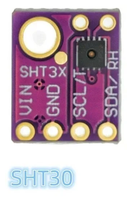

# Librería MicroPython SHT30 — SHT3x

**Versión:** 1.0  
**Plataforma de referencia:** LOLIN S2 Mini (ESP32-S2)  
**Interfaz:** I²C  
**Sensores compatibles:** SHT30, SHT31 y SHT35 de la familia SHT3x-DIS



---

## 1. Descripción

La librería `sht30.py` permite utilizar sensores de temperatura y humedad Sensirion SHT30, SHT31 y SHT35 mediante I²C.

La librería proporciona:

- Lectura de temperatura en grados Celsius.
- Lectura de humedad relativa en porcentaje.
- Medición única con tres niveles de repetibilidad.
- Comprobación CRC-8 de los datos recibidos.
- Reinicio por software.
- Lectura y borrado del registro de estado.
- Activación y desactivación del calentador interno.
- Gestión de errores mediante excepciones de MicroPython.

La librería utiliza el bus I²C creado por el programa principal, por lo que puede compartirlo con otros dispositivos, como una pantalla OLED SSD1306 o un expansor de entradas y salidas.

## 2. Compatibilidad

| Sensor | Compatibilidad |
|---|---|
| SHT30 | Sí |
| SHT31 | Sí |
| SHT35 | Sí |
| SHT40, SHT41, SHT45 | No directamente |

Los sensores SHT30, SHT31 y SHT35 de la familia SHT3x-DIS comparten los comandos utilizados por esta librería.

Las direcciones I²C habituales son:

- `0x44`
- `0x45`

La dirección depende de la configuración del pin `ADDR` del módulo.

## 3. Instalación

Copia el archivo `sht30.py` en el sistema de archivos del LOLIN S2 Mini utilizando Thonny, ampy u otra herramienta compatible con MicroPython.

El programa principal debe importar la clase:

```python
from sht30 import SHT30
```

No se requieren dependencias externas.

## 4. Conexión I²C

Ejemplo de inicialización para el LOLIN S2 Mini:

```python
from machine import Pin, I2C

i2c = I2C(
    0,
    scl=Pin(35),
    sda=Pin(33),
    freq=400000
)

print("I2C:", [hex(x) for x in i2c.scan()])
```

El escaneo debe mostrar la dirección del sensor, normalmente `0x44` o `0x45`.

## 5. Creación del objeto

```python
sht30 = SHT30(i2c, 0x45)
```

También se puede seleccionar el nivel de repetibilidad:

```python
sht30 = SHT30(i2c, 0x45, repeatability="high")
```

### Parámetros del constructor

| Parámetro | Tipo | Valor predeterminado | Descripción |
|---|---|---|---|
| `i2c` | Objeto I²C | Obligatorio | Bus I²C previamente creado. |
| `address` | Entero | `0x45` | Dirección I²C del sensor. |
| `repeatability` | Cadena | `"high"` | Nivel de repetibilidad de la medición. |

Valores admitidos para `repeatability`:

- `"high"`: alta repetibilidad.
- `"medium"`: repetibilidad media.
- `"low"`: baja repetibilidad.

La repetibilidad influye en el tiempo de medición y en el comportamiento de las lecturas. La precisión absoluta depende de las especificaciones del sensor utilizado.

## 6. API de la librería

### `measure()`

Realiza una medición de temperatura y humedad.

```python
sht30.measure()
```

El método:

1. Envía el comando de medición.
2. Espera el tiempo correspondiente al nivel de repetibilidad.
3. Lee los seis bytes de respuesta.
4. Comprueba el CRC de temperatura y humedad.
5. Convierte los valores brutos a unidades físicas.
6. Actualiza las propiedades `temperature` y `humidity`.

Devuelve una tupla con ambos valores:

```python
temperatura, humedad = sht30.measure()
```

Si la comunicación I²C falla o un CRC es incorrecto, se produce una excepción `OSError`.

### Propiedad `temperature`

Devuelve la temperatura de la última medición válida, en grados Celsius.

```python
temperatura = sht30.temperature
```

Para obtener un entero:

```python
temperatura = round(sht30.temperature)
```

Para truncar la parte decimal:

```python
temperatura = int(sht30.temperature)
```

La propiedad no inicia una nueva medición.

Antes de la primera medición válida, su valor es `None`.

### Propiedad `humidity`

Devuelve la humedad relativa de la última medición válida, en porcentaje.

```python
humedad = sht30.humidity
```

También puede redondearse:

```python
humedad = round(sht30.humidity)
```

Esta propiedad no inicia una nueva medición.

### `soft_reset()`

Envía el comando de reinicio por software.

```python
sht30.soft_reset()
```

Tras el reinicio, las propiedades vuelven a `None` hasta que se realice otra medición.

### `read_status()`

Lee y devuelve el registro de estado de 16 bits.

```python
estado = sht30.read_status()
print("Estado:", hex(estado))
```

La respuesta incluye un byte de CRC, que se comprueba antes de devolver el registro.

### `clear_status()`

Envía el comando de borrado de los indicadores de estado correspondientes.

```python
sht30.clear_status()
```

No todos los bits del registro tienen necesariamente el mismo comportamiento de borrado. Consulta la hoja de datos del modelo concreto.

### `heater(enabled=True)`

Controla el calentador interno del sensor.

Activarlo:

```python
sht30.heater(True)
```

Desactivarlo:

```python
sht30.heater(False)
```

El calentador modifica la temperatura del sensor y puede afectar a las mediciones. Debe mantenerse desactivado para las lecturas ambientales normales.

## 7. Funcionamiento del CRC

La librería verifica la integridad de los datos recibidos mediante CRC-8.

Parámetros del algoritmo:

- Polinomio: `0x31`.
- Valor inicial: `0xFF`.
- No se utiliza reflexión de bits.
- El CRC se calcula por separado para los dos bytes de temperatura y los dos bytes de humedad.

Cada bloque de dos bytes va acompañado de un byte CRC.

Si el CRC no coincide, se genera una excepción `OSError` en lugar de aceptar la lectura.

## 8. Código completo de `sht30.py`

```python
from time import sleep_ms


class SHT30:
    # Repetibilidad: "high", "medium" o "low"
    _COMMANDS = {
        "high":   (0x2C, 0x06, 16),
        "medium": (0x2C, 0x0D,  7),
        "low":    (0x2C, 0x10,  5),
    }

    def __init__(self, i2c, address=0x45, repeatability="high"):
        self.i2c = i2c
        self.address = address
        self.repeatability = repeatability

        self._temperature = None
        self._humidity = None

        if repeatability not in self._COMMANDS:
            raise ValueError(
                "repeatability: high, medium o low"
            )

        self.soft_reset()

    @staticmethod
    def _crc8(data):
        crc = 0xFF

        for byte in data:
            crc ^= byte

            for _ in range(8):
                if crc & 0x80:
                    crc = ((crc << 1) ^ 0x31) & 0xFF
                else:
                    crc = (crc << 1) & 0xFF

        return crc

    def _command(self, msb, lsb):
        self.i2c.writeto(
            self.address,
            bytes((msb, lsb))
        )

    def soft_reset(self):
        self._command(0x30, 0xA2)
        sleep_ms(2)

        self._temperature = None
        self._humidity = None

    def measure(self):
        msb, lsb, delay = self._COMMANDS[
            self.repeatability
        ]

        self._command(msb, lsb)
        sleep_ms(delay)

        data = self.i2c.readfrom(self.address, 6)

        # CRC de temperatura
        if self._crc8(data[0:2]) != data[2]:
            raise OSError(
                "CRC de temperatura incorrecto"
            )

        # CRC de humedad
        if self._crc8(data[3:5]) != data[5]:
            raise OSError(
                "CRC de humedad incorrecto"
            )

        temp_raw = (data[0] << 8) | data[1]
        humi_raw = (data[3] << 8) | data[4]

        self._temperature = (
            175.0 * temp_raw / 65535.0 - 45.0
        )

        self._humidity = (
            100.0 * humi_raw / 65535.0
        )

        return self._temperature, self._humidity

    @property
    def temperature(self):
        return self._temperature

    @property
    def humidity(self):
        return self._humidity

    def read_status(self):
        self._command(0xF3, 0x2D)
        sleep_ms(2)

        data = self.i2c.readfrom(self.address, 3)

        if self._crc8(data[0:2]) != data[2]:
            raise OSError(
                "CRC del estado incorrecto"
            )

        return (data[0] << 8) | data[1]

    def clear_status(self):
        self._command(0x30, 0x41)

    def heater(self, enabled=True):
        if enabled:
            self._command(0x30, 0x6D)
        else:
            self._command(0x30, 0x66)
```

## 9. Ejemplo completo para el LOLIN S2 Mini

Este programa realiza una medición cada dos segundos y muestra la temperatura y la humedad por el puerto serie.

```python
from machine import Pin, I2C
from time import sleep
from sht30 import SHT30

i2c = I2C(
    0,
    scl=Pin(35),
    sda=Pin(33),
    freq=400000
)

print("I2C:", [hex(x) for x in i2c.scan()])

sht30 = SHT30(i2c, 0x45)

while True:
    try:
        sht30.measure()

        temperatura = round(sht30.temperature)
        humedad = round(sht30.humidity)

        print("Temperatura:", temperatura, "C")
        print("Humedad:", humedad, "%")

    except OSError as e:
        print("Error SHT30:", e)

    sleep(2)
```

## 10. Ejemplo de integración con una OLED SSD1306

Si ya dispones de un objeto `oled` compatible con tu pantalla:

```python
from machine import Pin, I2C
from time import sleep
from sht30 import SHT30

i2c = I2C(
    0,
    scl=Pin(35),
    sda=Pin(33),
    freq=400000
)

sht30 = SHT30(i2c, 0x45)

while True:
    try:
        sht30.measure()

        temperatura = round(sht30.temperature)
        humedad = round(sht30.humidity)

        oled.fill(0)
        oled.text("Temperatura:", 0, 0)
        oled.text("{} C".format(temperatura), 0, 16)
        oled.text("Humedad:", 0, 32)
        oled.text("{} %".format(humedad), 0, 48)
        oled.show()

    except OSError as e:
        print("Error SHT30:", e)

    sleep(2)
```

La pantalla debe estar inicializada previamente. Si utilizas una librería de fuentes distinta de la estándar, adapta las llamadas de dibujo a su API.

## 11. Tratamiento de errores

Las operaciones I²C pueden generar `OSError` cuando:

- El sensor está desconectado.
- La dirección I²C es incorrecta.
- El bus no responde.
- Se detecta un CRC incorrecto.
- La respuesta del sensor no es válida.

Ejemplo:

```python
try:
    temperatura, humedad = sht30.measure()
except OSError as e:
    print("Error de lectura:", e)
```

La librería no sustituye una lectura fallida por valores inventados. Si se produce un error durante una medición, las propiedades conservan los últimos valores válidos.

## 12. Limitaciones y recomendaciones

1. Utiliza `measure()` para actualizar ambas medidas simultáneamente.
2. Lee después las propiedades `temperature` y `humidity` tantas veces como necesites.
3. Usa `round()` para obtener enteros redondeados y `int()` si deseas truncar decimales.
4. Mantén el calentador desactivado salvo que tengas una necesidad específica.
5. Comprueba la dirección con `i2c.scan()` antes de crear el objeto.
6. La librería implementa mediciones únicas. No incluye el modo periódico ni el modo ART.
7. El registro de estado se devuelve como un entero sin decodificar automáticamente sus bits.
8. Para instalaciones críticas, consulta la hoja de datos del sensor concreto y valida las condiciones eléctricas del bus I²C.

## 13. Referencia técnica

Hoja de datos oficial de la familia SHT3x-DIS:

https://sensirion.com/media/documents/213E6A3B/63A5A569/Datasheet_SHT3x_DIS.pdf

Esta documentación describe el uso de la librería y el código asociado. Las especificaciones eléctricas, los tiempos exactos de medición y los detalles del registro de estado deben contrastarse con la revisión de la hoja de datos correspondiente al sensor instalado.

