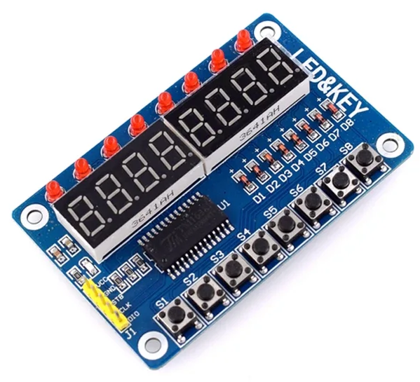
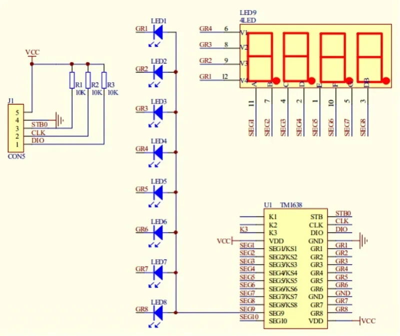
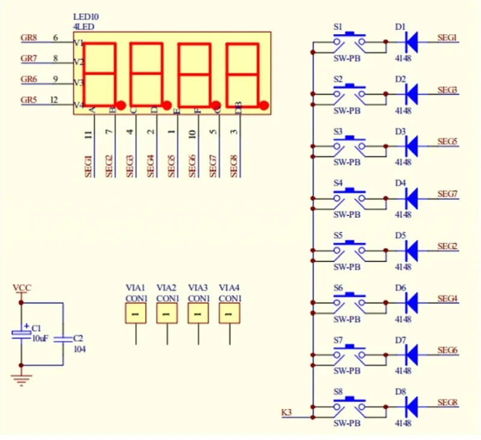

# MóDULO DE TECLADO + 8 LEDS + 8 DÍGITOS DE 7 SEGMENTOS CON TM1638

## Agradecimientos

la librería original es obra de [Mike Causer](https://github.com/mcauser/micropython-tm1638), compartida bajo licencia MIT, como este repositorio, y al que se le reconoce su autoría (Es de bien nacidos ser agradecidos)

## El módulo

## Mejoras

He añadido a la libreria una función que permite representar números con decimales:

~~~
    def decimal(self, num, decimals=1, pos=0):
        """Muestra un número decimal en el display.
        num: número a mostrar
        decimals: número de cifras decimales
        pos: posición inicial (0-7)
        """
        string = "{:.{}f}".format(num, decimals)
        self.segments(self.encode_string(string), pos)
~~~

Uso:

~~~
tm.decimal(12.6, 1, 4)    # 12.6 empezando en la posición 4
tm.decimal(3.14159, 2, 0) # 3.14
tm.decimal(25, 2, 0)      # 25.00
tm.decimal(-7.5, 1, 0)    # -7.5
~~~